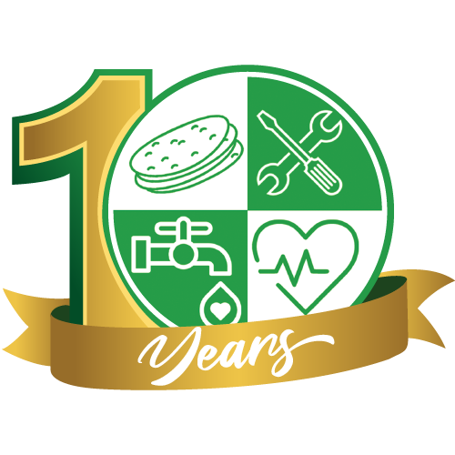

# Hammad Foundation — 11 Years Logo Competition

## 1. Brief (from email thread, 3 Nov 2026)

**Thread:** "Participation in the Logo Design Competition." with media@hammadfoundation.com

- **This is not a redesign.** The existing Hammad Foundation logo stays.
- They want an **"11 Years" anniversary mark** that is used alongside the existing logo.
- **Reference:** their existing **"10 Years" logo** (see §3).

### Official competition details (Facebook post + poster, ~3 Nov 2026)

| | |
|---|---|
| **Deadline** | **Before 20 November 2026** |
| **Prize** | PKR 25,000, paid only *if the design is selected and used* |
| **Submit to** | media@hammadfoundation.com |
| **Brief** | "Design a logo that tells our story, represents our mission, and leaves a lasting impact." "No limits on creativity." |
| **Poster tagline** | "Let your creativity represent our journey!" |
| **Hashtags** | #hammadfoundation #11yearsold #logodesign |

Files: `reference/competition-facebook-post.png` and `reference/competition-poster.webp`

**What the poster shows:**
- **The master (non-anniversary) logo** is in the top-right corner. It is the quartered emblem on a **dark-green rounded square**, with **"HAMMAD"** (green) set over **"FOUNDATION"** (white) in a bold geometric sans. This is the logo that "stays".
- **The monitor shows a naive "11" sketch.** It keeps the 10 Years layout and swaps the "1" for "11", with the emblem still acting as the "0". **It reads as "110 Years".** This is the trap to avoid (see §4), and probably a deliberate placeholder.
- **Poster styling:** a condensed bold sans (Bebas-like) in lime green and white, gold accent bars, and a white script. The background is the deep green `#0F3D22`–`#0B2E1A` range.
- **Their Facebook avatar** already uses a rough "11" version of the mark.

## 2. About the organisation (from hammadfoundation.com)

- **Karachi-based NGO.** The 10th anniversary was marked in early 2026 ("Decade of Change"), so the 11th falls in 2027. The founding year and chairman's name are not shown on the site. **Confirm both with the client.**
- **Mission:** a culture of *earning, learning and growth*, with empowerment over handouts.
  - "We promote a buying culture, not a begging culture."
  - "From Aid to Ability"
  - "Serving With Dignity"
- **Vision:** "Transforming Pakistan by 2050". The chairman lists four focus areas: women empowerment, youth empowerment, political awareness and social responsibility.
- **Hashtag:** `#hath_mai_hath_do_hammad_ka_sath_do` ("join hands, stand with Hammad")
- **Other taglines:** "Decade of Change, Be Part of the Journey" · "Partner in Hope" · "Empower change, one act of kindness at a time"
- **Projects:** Roti Bank · Heroics School · Medical Complex · Skill Valley · Quetta Skill Center · Water Plants · Water Dam · Legal Aid · Ramadan Bachat Camp · Rozgar Program · Free Medical Camps · Flood relief · Student Federation (HFSF) · Green / Civic Sense / Community campaigns
- **Impact figures on the site:**
  - 50,000 patients treated
  - 200 children in free school daily
  - 1,520 youth trained
  - 100 affordable roti daily
  - 60 medical camps
  - 100 families supported by Rozgar
- **Tone:** hopeful, dignified and community-led, with an emphasis on self-reliance. It is patriotic (Pakistan) and Islamic in its giving language (Sadqa, Zakat).

### 2027 goals (researched 4 Nov 2026)

- **No 2027-specific goals are published** on the website, its News & Stories page, or in press coverage. The only dated goal is **"Transforming Pakistan by 2050"**. **Ask the media team** whether year 11 has a theme or targets.
- **Chairman: Hammad Tanveer.** He frames himself as a Gen Z voice. His focus areas are women empowerment, youth empowerment, political awareness, social responsibility and **climate change**.
- **Recent activity that hints at direction:** Gen Z beach clean-ups (28 Sep 2025, 700+ volunteers; others with 3,000–4,000), **plantation drives** (Green Initiatives), and park takeovers in Karachi (9–11 Oct 2026). A Water Dam project aims at long-term water solutions. A campaign asks for Karachi to be made the capital.
- **Founding year clue:** the Facebook handle is `hammadfoundation2015`.

### Logo history (researched 4 Nov 2026)

- **Sources:** the site's WordPress media library (`/wp-json/wp/v2/media`) only goes back to Jan 2025, when the site was built from the Lenity theme. The Wayback Machine is blocked from the cloud session, and old social profile photos need a login. **Pre-2025 logos are still unknown.** Ask the media team, or browse the Facebook "Profile pictures" album.
- **Constant:** the round quartered emblem. It is unchanged on every sign, plaque and file. A 2084 px PNG of it is in `reference/logo-history/2026_02_website-01.png`.
- **Inconsistent:** the wordmark. The site alone has a thin sans, a serif (`logo-01.svg`, which is also a vector source of the 10 Years mark) and two heavy rounded faces. Signage uses bold caps. Each project sign uses its own colours (blue, dark green, white/green, lime vests).
- **9 Years mark ("Years of Change", 2025)**, shared by Hammad on 4 Nov: a white 9 whose bowl is the emblem, with a gold band for the tail reading YEARS / OF CHANGE. The wordmark is spaced bright-green HAMMAD over heavy white FOUNDATION. **Pattern:** every anniversary turns the emblem into the round part of the number (9's bowl, 10's zero). 11 has no round digit. The image file was not saved in the session, so the 02c placeholder `3062:3956` still needs it.
- **Background test findings:** the H tile is the most robust, but needs a keyline on deep green. G2's green ring vanishes on greens and photos. All gold fails on hi-vis lime, so vests need one-colour deep green or black. The ribbon word is unreadable below about 120 px.
- **Implication:** the 11 Years work should come with simple usage rules: a fixed lockup with the master logo, clear space, one-colour and reversed versions, and application examples (T-shirts, hi-vis vests, caps, banners, signboards). That gives them one system instead of a new logo every time.

## 3. How the existing 10 Years mark works (`reference/hf-10-years-logo.png`)

- **The master emblem itself forms the "0".** The emblem is a circle split into four quadrants that alternate green and white, each with a line icon:
  - **Roti** (Roti Bank / food)
  - **Wrench + screwdriver** (skills)
  - **Water tap** (water plants)
  - **Heart + ECG line** (health)
- **The "1"** is a tall, extruded gold numeral with a dark-green outline and a 3D side.
- **A gold ribbon** sweeps across the bottom, with *"Years"* in a white script.
- **The site uses this mark as its header logo** (`reference/hf-logo-main.png`, white wordmark) and as its favicon.

### Brand colours (from the site CSS and logo)

| Role | Hex |
|---|---|
| Primary green | `#00884C` (also `#279C49`) |
| Deep green | `#0F6030` |
| Navy (text / dark backgrounds) | `#020D19` |
| Accent orange (buttons) | `#FF6D00` |
| Anniversary gold | gradient, roughly `#C9A13B` → `#F2D27A` (sampled from the 10 Years ribbon; **approximate**) |

**Fonts on the site:** Onest, Inter, Montserrat.

## 4. The core design problem

**The 10 Years mark only works because the emblem is round and can stand in for "0". "11" has no zero.** The competition poster proves the point: putting "11" next to the emblem reads as **"110"**. So the 11-year mark needs a new way to fit the emblem in while still looking like the 10 Years mark (gold numerals, green emblem, gold ribbon with "Years").

Directions to explore:

1. **Two pillars:** gold "1 1" standing on either side of the emblem, like a gateway or two hands holding it. This ties in with *hath mai hath* (hand in hand).
2. **Emblem as the anchor:** the emblem sits in front, and the two 1s rise behind it like a skyline or upward growth, a nod to "Transforming Pakistan by 2050".
3. **Emblem on a "1":** the emblem sits as a seal or dot on the second 1, which becomes a step up from the 10 Years mark ("one more step").
4. **Ribbon-led:** "11" as a gold numeral inside a ribbon that wraps around the emblem, close to the 10 Years mark so the two read as a series.

Rules:
- Keep the emblem unchanged: the same quadrants, icons and greens.
- Keep the gold and green palette and the "Years" ribbon so the 10 and 11 marks look like a series.
- It must still read clearly at favicon and header size (around 70 px tall).

## 5. Deliverables (proposed)

- Primary lockup, plus a horizontal version for the website header
- Colour, single colour (green), and reversed (white on navy `#020D19`)
- Social media profile crop
- **Applications (requested 4 Nov):** printables for volunteers and campaigns, such as T-shirts, hi-vis vests, caps, banners, signboards and plaques. Include one-colour and screen-print-friendly versions (flat colour, no gradients) for fabric.
- Vector files (SVG, AI or PDF) and PNG exports

## 6. Open questions for the media team

- [ ] Founding year (2015 or 2016?) and whether "11 Years" needs a year range, e.g. "2016–2027"
- [ ] Vector source files of the emblem and the 10 Years mark
- [ ] Official brand colours and font for the "Years" script
- [x] Competition deadline: **before 20 Nov 2026** (submit to media@hammadfoundation.com)
- [ ] Submission format and file specs (none stated; plan to send a PDF presentation with PNG previews, and vectors on request)
- [ ] Any tagline for year 11 (the 10th used "Decade of Change")

## Reference files

- `reference/hf-10-years-logo.png`: the 10 Years mark, 500×500, from the site preloader
- `reference/hf-logo-main.png`: the header logo, 274×70, with a white wordmark
- `reference/hf-favicon.png`: the favicon, 300×300

Sources: [hammadfoundation.com](https://hammadfoundation.com/) · [About Us](https://hammadfoundation.com/about-us/) · [Dawn: How Karachi gives back in Ramazan](https://dawn.com/news/1899367)

## 7. Workflow & handoff (session 1 → session 2)

**Tools**
- **Artifacts:** quick SVG sketches and comparisons of concepts.
- **Figma:** the working board. File `fmHPTOHu3ddCyy2toFmtS3` ("Quick Projects"), page **"Hammad Foundation 11th Anniversary Logo"** (`3029:2`):
  https://www.figma.com/design/fmHPTOHu3ddCyy2toFmtS3/Quick-Projects?node-id=3029-2
- **Adobe Illustrator:** the final logo artwork is made here. Keep all SVGs clean and layered (named groups, no raster images, text converted to outlines at the end) so they open directly in Illustrator. The Adobe connector still needs to be authorised in claude.ai → Settings → Connectors.

**Figma board state**

| Section | Node | Status |
|---|---|---|
| 01 · Brief & Palette | `3033:2` | Done: brief bullets and 8 colour swatches |
| 02 · References | `3033:3` | Done: 10 Years mark, favicon, header logo (on navy), FB post and poster, each with a caption |
| 02b · Website Design Language | `3041:2` | Done (session 2): design-language notes, 7 site colours, homepage and About page screenshots (desktop and mobile), 14 project photos |
| 02c · Logo History | `3054:2` | Done (session 2): every logo file in the site's media library (2025–26) plus signage and vest crops from project photos |
| 03 · Concepts (from Artifacts) | `3033:4` | **Shortlist: E1 Twin Trees (Canopy), F Two Hands, G2 Line Grove (Circle), H1/H2 Doorway**, as editable vectors |
| 03 · Archive | `3047:2` | A, B, C, D, E2 and G1, set aside by Hammad on 4 Nov 2026 (cards kept at 60% opacity) |
| 04 · Refinement | `3033:5` | Background test done (session 2): the seven shortlisted concepts are components (`3061:449`–`3061:467`), with a 7 × 9 grid of instances on white, grey, nav green, deep green, navy, black, hi-vis lime, royal blue and a photo, plus findings |
| 05 · Illustrator Handoff | `3033:6` | Notes only |

**Next steps**
1. ~~Build an Artifact with SVG sketches of directions A–D.~~ **Done (session 2):** https://claude.ai/artifact/8mCZ5ibVnwYxwJw5j4Vbpa
   - Source: `concepts/build.mjs` (run `node concepts/build.mjs`) writes `concepts/svg/A–D-*.svg` and `concepts/index.html`.
   - The emblem is redrawn as vector shapes in a 200×200 box (`emblem()` in the script). Each SVG has named groups (`emblem`, `icon-roti`, `icon-tools`, `icon-tap`, `icon-heart`, `one-left`, `one-right`, `ribbon`) and no rasters.
   - "Years" is still live text in Dancing Script 700 (stand-in for the 10 Years script). Convert to outlines in Illustrator.
   - Sketch-level notes: A can read as "101"; B reads "11" most clearly; C has the smallest emblem; D is the closest sibling to the 10 Years mark.
   - Added from Hammad's ideas: **E1 Twin Trees · Canopy** (trunks with linked roots, emblem as canopy), **E2 Twin Trees · Grove** (trunk-1s with leaves rising behind the emblem) and **F Two Hands** (each 1 is a forearm and hand cupping the emblem like a globe). F reads as care first and "11" second, so it may need "11" on the ribbon.
2. ~~Import the concepts into section 03.~~ Done. **Shortlist (4 Nov): E1, F, G2, plus H1/H2 Doorway** (from Hammad's reference: the numeral as a lit doorway cut into a wall). A six-font numeral test (Bebas, Montserrat, Onest, Archivo Black, Outfit, Unbounded) was rejected, so the "11" should be drawn or made from negative space, not typed. **Bilingual idea (Hammad):** the Urdu numeral ۱۱ is two vertical strokes, so it looks almost the same as English 11. H3 (openings shaped like the Urdu ۱) and H4 (Mughal mehrab arches) read as both, with سال (years) in Noto Nastaliq Urdu on the ribbon. Confirm with the media team that an Urdu-first mark suits their audience. Next: refine in section 04.
   - Figma note: `use_figma` (board edits) asks for permission because of the Figma connector's own tool policy on claude.ai, not the repo settings. Set it to "Always allow" at claude.ai/customize/connectors → Figma.
3. Export the final SVG, polish it in Illustrator, and submit before **20 Nov 2026**.

**Website design language (from 02b):** bright nav green `#03B441`, button/stat green `#067530`, navy text `#020D19`, orange `#FF6D00` for small accents only, light grey `#F8F8F8` bands. Bold geometric sans headlines, letter-spaced eyebrow labels, rounded cards, circular photo crops, gold Urdu calligraphy ("جاری سفر", *the journey continues*). **Correction:** the orange two-hands-and-heart icon and orange accents come from **Lenity**, the WordPress charity theme the site is built on. They are not Hammad Foundation brand assets. Assets are in `reference/site/` (`photos/`, `shots/`).

**Permissions:** `.claude/settings.json` (committed by Hammad) allows routine tools, so new sessions should not keep asking for permission.
